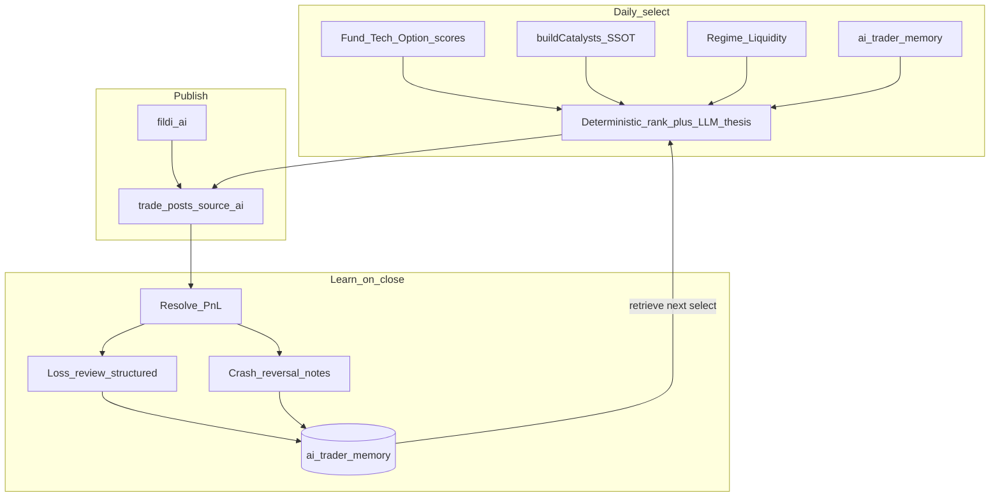

# product-ai-trader-account-research

| Field | Value |
|---|---|
| **Status** | ready |
| **Priority** | P0 |
| **Area** | research → product AI / feed |
| **Effort** | M (research); build phases spawn after |
| **Created** | 2026-07-09 |
| **Source** | user — system AI account, continuous learning, momentum judgment |
| **Research** | [agentic-workflow-research](1-agentic-workflow-research-070926.md) — floors **R3**, **R4**, **R5**, **R8**, **R9**, **R10** |
| **Related** | [ai/13](13-product-ai-trade-journal-loop-070926.md) (human journal — co-design tags), [enh/8](../enhancements/8-portfolio-analysis-improvements-070926.md) (schema owner), [enh/33](../enhancements/33-csp-momentum-backtest-learning-research-070926.md) (drivers + band regret + replay), [enh/30](../enhancements/30-liquidity-money-flow-research-070926.md) (liquidity context), [seq 7 leaderboard](../new_app_features/7-analyst-leaderboard-track-record-070926.md), [ai/3](3-agentic-lesson-memory-hygiene-070926.md), [ai/11](11-product-ai-explain-csp-070926.md), [enh/9](../enhancements/9-portfolio-daily-brief-improvements-070926.md) |
| **Type** | RESEARCH (locks contracts before ai/15–17) |
| **Impl research** | 2026-07-09 (this file) — **no app code** |

### Purpose
A public **system AI trader** that publishes top CSP ideas to the Feed, reviews losses, and improves via **structured memory retrieve** — not fine-tuning or auto-trading.

### Cache / DB compliance
Reuse scorecard / technicals / options / regime / catalysts already in DB or TTL caches. New tables only after Phase 0 with enh/8 + ai/13. **No** Redis. **No** second explain/brief LLM stack — reuse daily-brief / explain patterns. **Never** write P&L into `.cursor/context/lessons.md` (R5 / ai/3).

---

## 1. Executive summary

**Do not** fine-tune weights, auto-execute broker orders, replace `computeRankingsV2` / `computeOptionScore` with an LLM, or train on private human journal P&L without an explicit product decision.

**Do** research-lock:

1. System user `fildi_ai` — server-only publish  
2. Select = deterministic rank from existing scores + catalysts + regime (+ liquidity when enh/30 ships) + memory retrieve; LLM writes **thesis only**  
3. Driver tag on every idea (`fundamental_catalyst` \| `technical_momentum` \| `mixed` \| `income_only`) — algorithm owned by [enh/33](../enhancements/33-csp-momentum-backtest-learning-research-070926.md)  
4. Learn = loss reviews + outlier notes + (later) band-regret features into `ai_trader_memory`  
5. Phased builds: **ai/15** publish → **ai/16** review/memory → **ai/17** outliers  



---

## 2. Why

| Need | Evidence / gap |
|---|---|
| House-view CSP ideas with track record | Feed is human-only; no system publisher |
| Learn from bad AI trades in public | ai/13 is **human** journal; AI needs system-owned memory |
| Momentum judgment (news vs technical) | Scores exist; **driver labels** do not — enh/33 |
| Trust | Leaderboard + honest **n** (seq 7); badge `AI` |

---

## 3. Floors (non-negotiable)

| Floor | Implication |
|---|---|
| **R4** | Scores stay SSOT; LLM narrates / ranks candidates from scorer outputs |
| **R8** | Publish ideas only — never broker orders |
| **R5 / ai/3** | `ai_trader_memory` ≠ Cursor `lessons.md` |
| **R3** | Prefer extend explain/brief; no parallel mystery Haiku pipeline |
| **R9/R10** | Daily publish + review token budget; rate-limit news joins |

---

## 4. System user contract

| Field | Decision |
|---|---|
| Username | `fildi_ai` (display “FILDI AI”) |
| Role | Prefer new role `system` **or** `member` + `isSystem=true` flag — research execution picks one; **cannot** interactive login |
| Password | Unusable hash / no login path |
| Avatar | Fixed brand mark |
| Posts | Only via server job (`publishAiIdeas`) — not public POST as session user |
| Badge | UI: `source=ai` or username === `fildi_ai` → “AI” chip on TradeCard |
| Leaderboard | Eligible under same closed≥5 rules as humans (seq 7) |

Schema note: `users.role` today is `'admin' \| 'member'` ([schema](../../lib/db/src/schema/index.ts) L12) — extending role or adding column is a migration owned with enh/8 Phase 0 if needed.

---

## 5. Select contract

### Inputs (already in stack)

| Input | Source |
|---|---|
| Fundamental score / families | Rankings / `ticker_fundamentals` |
| Technical score / signal GO\|WATCH\|NO | Scorecard / `ticker_technicals` |
| Best CSP strike | `pickBestStrike` / `computeOptionScore` |
| Regime | `/api/macro/regime` VIX-band |
| Catalysts | Server `buildCatalysts` ([lib/catalysts.ts](../../artifacts/api-server/src/lib/catalysts.ts)) — SSOT; FE duplicate is L-05 / enh/12 |
| Liquidity (soft) | enh/30 Net Liq / sector leadership when shipped |
| Memory | Top-K similar `ai_trader_memory` rows |

### Ranking (deterministic first)

1. Filter: CSP-eligible (GO preferred; WATCH optional); liquidity gate pass; min income floor for regime  
2. Sort: optionScore / stock score composite (document exact weights in ai/15)  
3. Attach **`momentum_driver`** via enh/33 rules  
4. Cap **N ≤ 3** ideas per calendar day (token + feed noise)  
5. LLM thesis: notes field only — cite scores + catalysts + driver; **no** invented metrics  

### Overlap with seq 6 / home picks

| Surface | Owner |
|---|---|
| Client GO cards (home/picks) | new_app_features/4–6 — no `trade_posts` |
| AI published ideas | This track — Feed posts with track record |

CTA: home can link “See FILDI AI ideas” → `/feed?username=fildi_ai` — do not duplicate publish.

---

## 6. Publish path

| Decision | Detail |
|---|---|
| Storage | Reuse `trade_posts` (`SELL_PUT`, strike, expiry, premium, notes, signal/regime/iv at entry if columns exist) |
| Marker | Add nullable `source text` default `human` \| `ai` **or** detect via userId — prefer explicit `source` for queries |
| Job | `publishAiIdeas` cron/admin trigger — not user-facing button v1 |
| Snapshot | At publish, persist **band neighbors** (best-N strikes in delta/OTM band) for later regret ([enh/33](../enhancements/33-csp-momentum-backtest-learning-research-070926.md)) — JSON column or side table |
| Explain | Optional link to ExplainableScore / ai/11 — click-only |

---

## 7. Learn — memory model

### Co-design with ai/13 / enh/8

| Concern | Rule |
|---|---|
| Tag vocabulary | Shared enum where possible (`thesis_wrong`, `ignored_rsi`, `event_risk`, …) |
| Human journal | Private to user; **AI does not read human P&L** in v1 |
| AI memory | System-owned rows only |
| Migration owner | enh/8 Phase 0 decides columns vs `ai_trader_memory` table; ai/13 + ai/14 must not fork two tag systems |

### `ai_trader_memory` sketch (research — not final DDL)

| Column | Purpose |
|---|---|
| `id`, `created_at` | PK |
| `kind` | `loss_review` \| `outlier_note` \| `band_regret` \| `win_pattern` (win = v2) |
| `ticker`, `post_id` nullable | Link |
| `tags text[]` | Shared vocab |
| `summary` | Short structured text |
| `features jsonb` | RSI/MFI/IV/regime/driver/regret stats at entry |
| `embedding` | **Out of scope v1** — SQL filter on ticker/tags/features |

### Retrieve on select

```
WHERE ticker IN candidates OR tags overlap
ORDER BY created_at DESC
LIMIT K (e.g. 5)
→ inject into thesis prompt + soft down-rank if loss_review matches setup
```

**No** silent mutation of scorer weights (R4/R8).

### Loss review (ai/16)

On `CLOSED` with `resolved_pnl <= 0` for AI posts:

1. Deterministic feature dump at entry (from post + snapshot)  
2. LLM: “which risks were taken; which indicators should have warned” — grounded in dump only  
3. Store `loss_review` + tags  

### Outliers (ai/17)

Deterministic: e.g. −X% in ≤Y sessions then +Z% reverse within W days (thresholds locked in ai/17 PRD using `prices_historical`). Draft note → optional admin approve → `outlier_note` memory (“mean-reversion CSP candidate”).

---

## 8. Phased stubs (spawn after research checklist)

| Seq | Stub | Scope |
|---|---|---|
| **ai/15** | System user + daily publish from scores | Seed user, job, Feed badge, N≤3, driver tag field |
| **ai/16** | Loss review + memory retrieve | Table/columns, close hook, select retrieve |
| **ai/17** | Outlier crash→reversal notes | Detector + memory kind |

Wire **band regret** from enh/35 into memory when that ships (soft dep).

---

## 9. Out of scope

| Item | Reason |
|---|---|
| Broker auto-trade | R8 |
| Fine-tune / vector mega-memory | ai/1 SKIP |
| Write Cursor `lessons.md` | R5 |
| Replace scorers with LLM | R4 |
| Train on human journal P&L | Privacy — v1 ban |
| Second daily-brief product | enh/9 |
| Social scrape as alpha | Noise / ToS |

---

## 10. Research execution checklist

- [ ] Confirm `users` extension (`system` role vs flag) with auth middleware  
- [ ] Agree tag vocab draft with ai/13 + enh/8 Phase 0  
- [ ] Confirm `trade_posts` columns for entry context (signal/regime/iv already?)  
- [ ] Token budget: 3 theses/day + ≤3 loss reviews/day  
- [ ] Mark ai/15–17 filenames in INDEX when spawning  
- [ ] No app code in this research task  

---

## 11. Success criteria

- System-user + badge + `source=ai` contract written  
- Select inputs listed from existing stack; driver tags deferred to enh/33 algorithm  
- Learning = retrieve + tags, not fine-tune — explicit  
- Phased ai/15–17 named; deps on ai/13/enh/8/enh/33/enh/30 noted  

---

## 12. Impact & Risk (for later builds)

### Blast radius
- `users`, `trade_posts`, feed UI, optional new memory table  
- Rollback: disable job; hide AI badge  

### Bug risks
- AI posts flooding feed — hard daily cap  
- LLM inventing scores — prompt must bind to JSON features only  
- Memory polluting human journal queries — filter `source=ai` / system userId  

---

## Review (2026-07-09)

**Verdict:** APPROVE — ready as research SSOT for AI trader account  
**Key:** System user + deterministic select + memory retrieve; drivers/regret owned with enh/33; floors R3–R10.
