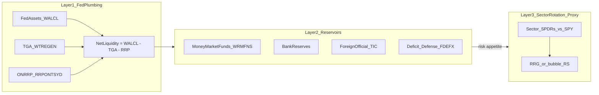

# liquidity-money-flow-research

| Field | Value |
|---|---|
| **Status** | ready |
| **Priority** | P0 |
| **Area** | research → macro ui/data |
| **Effort** | M (research); build phases spawn after |
| **Created** | 2026-07-09 |
| **Source** | user theory (stimulus economy + sector rotation) + competitive liquidity dashboards |
| **Research parent** | [feature-purpose-research](1-feature-purpose-research-070926.md) |
| **Related** | [macro-regime-tab](10-macro-regime-tab-improvements-070926.md), [macro-heatmap-tab](19-macro-heatmap-tab-improvements-070926.md) (**non-collision**), [macro-volatility](17-macro-volatility-tab-improvements-070926.md), [macro-policy](18-macro-policy-tab-improvements-070926.md), [home-dashboard](../new_app_features/4-home-dashboard-redesign-070926.md), [ai/14](../ai/14-product-ai-trader-account-research-070926.md) (Net Liq / sector leadership soft input to AI select), [enh/33](33-csp-momentum-backtest-learning-research-070926.md) (seq **31/32** = liquidity builds; **33+** = momentum/replay — do not collide) |
| **Type** | RESEARCH (locks proxies + UI before implementation PRDs) |
| **Impl research** | 2026-07-09 (this file) — **no app code in this task** |

### Purpose
Answer for a CSP trader: *Is the dollar plumbing injecting or draining, where is cash parked, and which sectors are leading the rotation?* — with **honest proxies**, not a fake cash Sankey.

### Cache / DB compliance
Reuse `fetchFredCSV` + existing `macro-charts` file cache (4h). Prefer extending `MacroCharts` / one new `GET /api/macro/liquidity` that composes FRED series already in the FRED path. **No** Redis. **No** paid EPFR. **No** hijacking Heatmap tab ([enh/19](19-macro-heatmap-tab-improvements-070926.md) forbids custom sector API / FILDI treemap).

---

## 1. Executive summary

**Do not** claim measured dollars moved from semis → software. True inter-sector cash ledgers are not public.

**Do** research-lock three layers professionals already use (CondorEdge / Convex / StreetStats):

1. **Fed plumbing** — Net Liquidity = Fed assets − TGA − ON RRP  
2. **Reservoirs / fiscal** — MMF assets, bank reserves, deficit, defense outlays, foreign official (TIC, lagged)  
3. **Sector rotation proxy** — SPDR (and SMH) **relative strength / RRG-style bubbles** vs SPY  

**UI target (post-research build):** new Macro tab **Liquidity** (or Regime subsection) — plumbing diagram + sparklines + sector bubbles — with CSP CTAs to scanner/watchlist by leading sector.

**Already in repo:** `moneyMarketHistory` via FRED **`WRMFNS`** (not MMMFNS), `nfciHistory` via **`NFCI`** in [`macro-data.ts`](../../artifacts/api-server/src/lib/macro-data.ts) (~L77, L820–821). Surface them in a liquidity *story*; do not re-fetch under a second path.

---

## 2. Hypothesis map (user theory → measurable)

| Claim | Mechanism | Measurable proxy | Cadence |
|---|---|---|---|
| Economy is government-stimulated | Deficit spend / TGA drawdowns inject reserves | TGA ↓ → Net Liq ↑; deficit series; defense `FDEFX` | Weekly / monthly / quarterly |
| Flows through banks / defense | Fiscal → deposits / contractors → risk assets | Reserves + defense + XLF/XLI/ITA relative strength | Mixed |
| Constant sector rotation | Leadership rotates semis, software, consumer, commodities | SPDR RS vs SPY; RRG quadrants | Daily |
| High-level entities park cash | MMFs, foreign official Treasuries | `WRMFNS` (have); TIC foreign official | Weekly / monthly lagged |



---

## 3. Series catalog (lock before build)

### 3.1 Layer 1 — Fed plumbing (P0 for phase A)

| Role | FRED ID | Cadence | In repo today? |
|---|---|---|---|
| Fed total assets | `WALCL` | Weekly | **No** — add |
| Treasury General Account | `WTREGEN` | Weekly | **No** — add |
| Overnight RRP | `RRPONTSYD` | Daily | **No** — add |
| **Derived** Net Liquidity | `WALCL − WTREGEN − RRPONTSYD` (align dates) | Derived | **No** |

**English:** Rising Net Liquidity ≈ more dollars available to markets; TGA rebuild or RRP fill drains; RRP drain can offset QT (buffer story — label in UI).

### 3.2 Layer 2 — Reservoirs / fiscal (phase A surface existing; phase C add)

| Role | Series / source | Cadence | In repo today? |
|---|---|---|---|
| Money market fund assets | FRED **`WRMFNS`** (code comment historically said MMMFNS — **use WRMFNS**) | Weekly | **Yes** — `moneyMarketHistory` |
| Financial conditions | FRED **`NFCI`** | Weekly | **Yes** — `nfciHistory` |
| Reserve balances | **`WRESBAL`** (locked — weekly, aligns with WALCL/WTREGEN cadence; TOTRESNS rejected as monthly-only, too coarse against weekly plumbing series) | Weekly | No |
| Federal deficit | `MTSDS133FMS` (Monthly Treasury Statement) | Monthly | No |
| Defense consumption | `FDEFX` | Quarterly | No |
| Foreign official holdings | **`BOGZ1FL263061130Q`** (locked — Fed Z.1 "Treasury Securities Held by Foreign Official Institutions"; best FRED-native broad foreign-official series, raw TIC MFHHIS monthly data isn't FRED/CSV-fetchable) | Quarterly lagged | No |
| FiscalData MTS | treasury.gov FiscalData API | Monthly | Optional alt to FRED deficit |

### 3.3 Layer 3 — Sector rotation (phase B)

| Role | Instrument | Method | Vendor |
|---|---|---|---|
| Benchmark | SPY | RS denominator | Yahoo (existing) |
| Sectors | XLK, XLC, XLY, XLP, XLE, XLF, XLV, XLI, XLB, XLRE, XLU | Price RS + momentum → RRG / bubbles | Yahoo |
| Semis overlay | SMH (optional) | Same | Yahoo |
| **Not v1** | EPFR / Bloomberg ETF **dollar** flows | Paid | Out of scope |
| **Gate for DIY flows** | shares outstanding × NAV | Fragile on Yahoo — only if research proves stable | Phase C optional |

### 3.4 Proxy honesty table (CSP trust)

| Chart | Proves | Does **not** prove |
|---|---|---|
| Net Liquidity | Plumbing inject/drain vs TGA/RRP | Which sector received the dollars |
| MMF assets (`WRMFNS`) | Cash parked in MMFs | Imminent equity buy |
| NFCI | Broad financial conditions stress/ease | Single-name CSP safety |
| Defense / deficit | Fiscal impulse size | Pass-through timing to XLI/ITA |
| TIC foreign official | Slow foreign official positioning | Daily tape driver |
| Sector RRG / bubbles | **Relative price leadership** | True ETF creation/redemption cash flow |
| Fake Sankey “$ from XLK→XLE” | — | **Forbidden** — invents accounting |

---

## 4. UI recommendation

### Placement
- **Preferred:** new Macro tab id `liquidity` — label **Liquidity** — between Regime and Volatility (or after Policy).  
- **Alt:** Regime subsection “Dollar plumbing” — only if tab budget is tight; research default = **own tab** so Heatmap stays TV-only ([enh/19](19-macro-heatmap-tab-improvements-070926.md)).

### Wireframe (top → bottom)

```
[Liquidity header + as-of dates]
[Net Liquidity big number + Δ 1w/1m]
[Plumbing strip: WALCL | −TGA | −RRP  →  Net]  ← simple flow diagram, not Sankey
[Sparklines: Net Liq, RRP, TGA, MMF, NFCI]
[Sector rotation: bubble or RRG — size=RS or 1m return; color=momentum quadrant]
[CSP strip: “Leading: XLK, SMH — open scanner / filter watchlist”]
[Honesty footnote: proxies, not cash ledger]
```

### CSP job
Morning: plumbing OK? → which sectors lead? → point scanner at those names (deep-link patterns from enh/15 / seq 5).

### Non-collision
| Surface | Owns |
|---|---|
| **This research → Liquidity tab** | Net Liq + MMF/NFCI story + FILDI sector bubbles/RRG |
| **enh/19 Heatmap** | TradingView embed + watchlist-by-sector chips — **no** custom treemap |
| **enh/10 Regime** | VIX-band CSP income + what-changed strip — link *to* Liquidity, don’t duplicate Net Liq charts |

---

## 5. Phased build split (spawn after this research is accepted)

| Phase | Stub task (create when research done) | Scope | Effort |
|---|---|---|---|
| **A** | `31-liquidity-plumbing-ui-…` | Add WALCL/WTREGEN/RRPONTSYD + derived Net Liq to macro charts/API; Liquidity tab plumbing + surface existing MMF/NFCI | S–M |
| **B** | `32-sector-rotation-viz-…` | SPDR(+SMH) RS/RRG or bubble chart; CSP CTAs; no paid flows | M |
| **C** | optional later | Deficit/defense/TIC overlays; DIY ETF flow **only if** Yahoo shares-outstanding audit passes | L |

**Do not** write full ai/2 implementation PRDs until series IDs above are confirmed in a research pass (FRED page check for reserves/TIC).

---

## 6. Out of scope

| Item | Reason |
|---|---|
| Literal inter-sector cash Sankey | Not published; false confidence |
| Paid EPFR / Bloomberg flows | Cost |
| StockTwits / social “sentiment” as liquidity | Wrong product ([new_app_features/9](../new_app_features/9-social-sentiment-polish-070926.md)) |
| Redis / job queue | P3 eng |
| Replace TradingView Heatmap | enh/19 |
| New scoring engine | Proxies inform judgment; scores stay SSOT |

---

## 7. Existing code (baseline)

| Asset | Path / evidence |
|---|---|
| `fetchFredCSV` | `macro-data.ts` ~L708 |
| Money market history | `fetchFredCSV("WRMFNS")` ~L820 → `moneyMarketHistory` |
| NFCI history | `fetchFredCSV("NFCI")` ~L821 → `nfciHistory` |
| MacroCharts type (FE) | `macro-page-types.ts` — includes `moneyMarketHistory`, `nfciHistory` |
| Macro tabs | `MacroTab` = regime \| volatility \| policy \| heatmap \| catalyst — **no liquidity yet** |
| Regime improvements | [enh/10](10-macro-regime-tab-improvements-070926.md) — derive from cache |
| Heatmap improvements | [enh/19](19-macro-heatmap-tab-improvements-070926.md) — TV only |

---

## 8. Research execution checklist (this task’s “done”)

- [x] Confirm FRED pages for `WALCL`, `WTREGEN`, `RRPONTSYD` (units $B alignment) — confirmed via StreetStats/QuantWave/MacroMicro cross-reference (2026-07-13)
- [x] Pick reserve series ID (`WRESBAL` vs `TOTRESNS`) and one TIC foreign-official series — locked `WRESBAL` + `BOGZ1FL263061130Q` (see §3.2)
- [x] Document date-alignment rule for Net Liq (daily RRP vs weekly WALCL/TGA) — resample `RRPONTSYD` to weekly (Wed close / same-week last obs) before subtracting; implemented in `deriveNetLiquidity()` in `macro-data.ts`
- [x] Confirm `WRMFNS` is the intended MMF series (vs any MMMF* alias) — code already uses WRMFNS
- [x] Choose bubble vs classic RRG for phase B — **bubbles + quadrant legend** confirmed (no RRG-tail component exists in repo; recharts `ScatterChart` supports bubbles natively, not RRG tails)
- [x] Web-search confirmed no public tool traces literal inter-entity dollar flows (2026-07-13) — StreetStats/NetLiquidity.org/QuantWave/MacroMicro all show plumbing arithmetic only; StockCharts RRG/TradingView money-flow scripts show relative-strength proxies only. Reinforces §6 "no literal Sankey" ban.
- [~] Mark phase A/B stub filenames in INDEX when spawning 31/32 — **built directly instead of spawned as separate stub tasks**, per user request to see a working tab; see session plan for Phase A/B scope
- [x] No app code in this research task — **superseded**: user explicitly asked to proceed to build Phase A/B in this session (see Purpose note below)

---

## 9. Success criteria

- [x] Locked FRED ID list for Net Liquidity + 5–10 reservoir/fiscal candidates — `WALCL`, `WTREGEN`, `RRPONTSYD`, `WRESBAL`, `BOGZ1FL263061130Q` (see §3.2)
- [x] Explicit **no** on literal cash Sankey; **yes** on RRG/bubble rotation proxy — implemented as quadrant-colored bubble scatter (leading/weakening/lagging/improving), not RRG tails
- [x] Macro **Liquidity** tab placement + wireframe above — shipped between Regime and Volatility tabs
- [x] Deps: extend `fetchFredCSV` / macro-charts TTL — no parallel FRED client — reused existing `fetchFredCSV`/`Promise.allSettled` pattern in `macro-data.ts`, same 4h TTL
- [~] Follow-ons named: **31 plumbing UI**, **32 sector rotation viz** — **built directly in this session instead of spawned as separate stub tasks**, per explicit user request (2026-07-13) to see a working Liquidity tab rather than gate further on stub PRDs. See §11 below for what shipped.

## 11. Build note (2026-07-13) — Phase A/B shipped in this session

Despite this task's original "no app code" gate, the user explicitly asked to proceed straight to a working tab after the research findings above were locked. What shipped:

- **Backend** (`artifacts/api-server/src/lib/macro-data.ts`, `artifacts/api-server/src/routes/macro.ts`): `fetchFredCSV` fetchers for `WALCL`/`WTREGEN`/`RRPONTSYD`/`WRESBAL`, `deriveNetLiquidity()` with weekly-alignment rule (RRP resampled to WALCL's Wednesday cadence), extended `MacroCharts` + cache guard; new `fetchSectorRotation()` (SPY + 11 SPDRs + SMH, price-based relative strength vs SPY) behind `GET /api/macro/sector-rotation` with its own 30min `TTLCache`.
- **Frontend** (`macro.tsx`, `MacroComponents.tsx`, `macro-page-types.ts`): new `"liquidity"` tab — `LiquidityFlowDiagram` (plumbing cards with real $ + 1w/1m deltas, honest since it's real subtraction) → conceptual directional divider (explicitly labeled proxy, not measured flow) → `SectorRotationBubbles` (recharts `ScatterChart`, quadrant-colored, CSP "Leading: X, Y" strip).
- Verified: both `tsc` passes clean; both new endpoints hit live and returned sane data — Net Liquidity computed to $5,958.2B, matching an independently-sourced $5,959B figure from research; sector rotation returned plausible July-2026 quadrants (XLF/XLV/XLI/XLU leading, XLK/SMH cooling into lagging after a 3m rally). Manual browser check was not possible — Playwright's Chromium isn't installed in this environment.

---

## 10. Impact & Risk (for later builds)

### Blast radius
- `macro-data.ts` charts payload shape → bump cache version / guard like existing field checks (~L882)  
- `macro.tsx` new tab; FE `MacroCharts` type  

### Bug risks
- Mixing $M vs $B units across series → wrong Net Liq  
- Calling RRG “money flow” in copy → trader overtrust  
- Double-fetching WRMFNS/NFCI under a second route  

### Rollback
- Hide Liquidity tab; charts fields unused  

---

## Review (2026-07-09)

**Verdict:** APPROVE — ready as research SSOT  
**Key:** Three-layer proxy model; WRMFNS+NFCI already fetched; new Liquidity tab; Heatmap non-collision; phases 31/32 after checklist.
