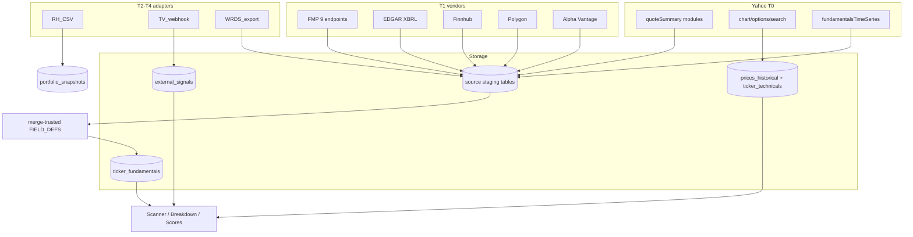

# data-source-integration (research v2)

| Field | Value |
|---|---|
| **Status** | ready (research — expanded 2026-07-10) |
| **Priority** | P1 |
| **Area** | research / data architecture |
| **Supersedes** | v1 shallow tier table + 3-line “Best At” summaries |
| **Related** | [enh/2](../enhancements/2-competitive-tech-research-070926.md), [enh/24](../enhancements/24-polygon-av-backfill-completion-070926.md), [enh/30](../enhancements/30-liquidity-money-flow-research-070926.md), `.claude/skills/data-architecture.md`, `.claude/docs/phase-report-github-enhancements.md` (Yahoo call index) |

### Purpose
**Inventory-first** map of every data membership and every Yahoo (and vendor) capability — what TradeDash uses, what it ignores, where to invest next. No app code until child PRDs.

### v1 problem (fixed here)
Prior draft collapsed Yahoo into “T0 automated pipeline” and competitive “Best At” blurbs. Yahoo alone exposes **10+ top-level API methods**, **34 quoteSummary modules**, options chains, news search, macro indices, and `fundamentalsTimeSeries` — TradeDash uses ~15% of that surface. This doc is the SSOT for closing that gap deliberately.

---

## 1. Methodology

- **Code-verified:** `codegraph_explore` + grep across `artifacts/api-server/` (2026-07-10).
- **Library SSOT:** [yahoo-finance2@3.14+](https://jsr.io/@gadicc/yahoo-finance2) module list (quoteSummary modules, Nov 2024 financial-statement deprecation).
- **Merge SSOT:** `merge-trusted.ts` FIELD_DEFS priority chains.
- **Status legend:** ✅ wired in prod path · 🟡 partial / backfill only · ⬜ available, unused · 🚫 deprecated / do not use · 🔒 needs membership

---

## 2. Master source inventory

| Source | Auth | Budget (TradeDash) | Bronze / staging table | In FIELD_DEFS merge | Serve-time (TTLCache) | Batch scripts |
|---|---|---|---|---|---|---|
| **Yahoo Finance** | None | ~2000/hr (soft) | `yahoo_fundamentals` | ✅ #1 priority most fields | ✅ heavy (stocks, macro, options) | `backfill-yahoo.ts`, nightly-enrichment |
| **SEC EDGAR** | None (User-Agent) | Generous | `edgar_fundamentals` | ✅ balance sheet, income $ | ⬜ | `backfill-edgar.ts` |
| **Finnhub** | `FINNHUB_API_KEY` | 60/min | `finnhub_fundamentals` | ✅ ratios, growth | 🟡 peer-resolver only | `backfill-finnhub.ts` |
| **FMP** | `FMP_API_KEY` | 220/day (`api_usage`) | `fmp_fundamentals` | ✅ fallback / WACC / ROIC | ⬜ | nightly-enrichment, SDM |
| **Polygon** | `POLYGON_API_KEY` | 5/min | `polygon_fundamentals` | 🟡 margins, debt (low priority) | ⬜ | `backfill-polygon.ts` |
| **Alpha Vantage** | `ALPHA_VANTAGE_API_KEY` | 25/day | `av_fundamentals` | 🟡 valuation ratios | ⬜ | `backfill-av.ts` |
| **FRED** | `FRED_API_KEY` | Keyed | file cache + macro JSON | N/A (macro) | 🟡 macro-data | macro refresh |
| **Treasury.gov** | None | — | macro charts file | N/A | 🟡 yield curve CSV | macro refresh |
| **NY Fed GSCPI** | None | — | macro charts file | N/A | 🟡 | macro refresh |
| **CNN Fear & Greed** | None | — | macro charts file | N/A | 🟡 | macro refresh |
| **FactSet** | Proxy + SDM | Manual / capped | none in merge | ⬜ admin only | ⬜ | `stock-data-manager` |
| **WRDS / Refinitiv** | Edu 🔒 | Batch | ⬜ not wired | ⬜ planned T2 | ⬜ | — |
| **Robinhood Agentic** | Personal | Human | `portfolio_snapshots` | N/A | ⬜ | CSV ingest |
| **TradingView** | Personal 🔒 | Webhook tier | ⬜ | N/A (signals bus) | widgets only | — |
| **Coinbase Premium** | Personal 🔒 | Daily snapshot | ⬜ | N/A | ⬜ | — |

**Fundamentals pipeline:** Yahoo → EDGAR, Finnhub, Polygon, AV, FMP → `merge-trusted` → `ticker_fundamentals` → scoring.

**Parallel paths (not merge):** options/technicals (Yahoo options + OHLCV), macro (FRED + Yahoo indices), portfolio (RH CSV), FactSet admin cross-check.

---

## 3. Yahoo Finance — full capability matrix

**Library:** `yahoo-finance2` (v3.14.1 in repo). **Always pass** `{ validateResult: false }` on options and many chart/historical calls ([MEMORY.md](../../../.agents/memory/yahoo-finance2-options.md)).

### 3.1 Top-level API methods

| Method | Yahoo provides | TradeDash usage | Files / routes | Cache / persist | Gap |
|---|---|---|---|---|---|
| **`quote(symbol)`** | Real-time price, change, mkt cap, 52w, pre/post mkt | ✅ Macro indices, sector ETFs, highlights | `macro-data.ts`, `macro-highlights.ts`, `macro-regime.ts` | TTL / file (`macro-charts.json`) | Not used for equity quote route (uses quoteSummary instead) |
| **`quoteSummary(symbol, { modules })`** | Modular fundamental + ownership + calendar bundle | ✅ Primary equity data API | `stocks.ts`, `yahoo-client.ts`, `fundamentals.ts`, `seeder.ts`, `peer-resolver.ts` | Per-route TTLCache 1–2h; bronze via backfill | 19 of 34 modules never requested |
| **`chart(symbol, { period1, interval })`** | OHLCV + adj close, intraday–monthly | ✅ Price history UI, macro series | `stocks.ts` (`/history`), `macro-data.ts` | `historyCache` 1h / 15m; macro file | Could replace deprecated `historical()` in indicators |
| **`historical(symbol, { period1, period2, interval })`** | Daily OHLCV (legacy interface) | 🟡 Scorecard bootstrap only | `indicators.ts` → `prices_historical` | DB INSERT OR IGNORE | Deprecated upstream; migrate to `chart()` |
| **`options(symbol, { date? })`** | Full chain: calls/puts, IV, OI, greeks (partial), expiries | ✅ CSP scanner, technical IV rank | `options.ts`, `technicals-db.ts` | `optionsCache` 30m, `expiryCache` 24h | Calls side unused; no persist of term structure |
| **`search(query, { newsCount, quotesCount })`** | Symbol lookup + news articles | ✅ Search bar + breakdown news | `stocks.ts`, `macro-highlights.ts` | `searchCache` 24h | `researchReports`, trending flags unused |
| **`fundamentalsTimeSeries(symbol, { type, module })`** | Annual/quarterly statements (post-Nov-2024 SSOT for statements) | 🟡 Backfill + ROIC/WACC calc only | `yahoo-client.ts` | `yahoo_fundamentals` bronze | Not used at serve-time; quarterly panel not in UI |
| **`insights(symbol)`** | Analyst reports summary, sig devs, ups/down | ⬜ | — | — | **High value for breakdown / ai/11** |
| **`screener(preset, …)`** | Prebuilt screens (day_gainers, undervalued_growth, etc.) | ⬜ | — | — | **Finviz-style scanner seed** |
| **`trendingSymbols(region)`** | Trending tickers | ⬜ | — | — | Feed / “today’s movers” ([naf/6](../new_app_features/6-todays-top-picks-feed-070926.md)) |
| **`recommendSymbolsByIndustry`** | Industry peers suggestion | ⬜ | — | — | Alternative to Finnhub peer API |
| **`dailyGainers` / `dailyLosers`** | Market movers | ⬜ | — | — | Macro highlights extension |
| **`quoteCombine`** | Batch quotes | ⬜ | — | — | Could cut macro regime from 4→1 call |

### 3.2 `quoteSummary` modules (all 34)

Yahoo deprecated statement history modules Nov 2024 — use `fundamentalsTimeSeries` instead.

| Module | Data available | TradeDash | Used in | Product fit if wired |
|---|---|---|---|---|
| `price` | Last, bid/ask, mkt cap, pre/post | ✅ | compare, quote, breakdown | Real-time Tier B |
| `summaryDetail` | P/E, div yield, 52w, beta, shares | ✅ | all stock routes, yahoo-client | Core valuation |
| `financialData` | Margins, ROE/ROA, targets, FCF, growth | ✅ | all stock routes, yahoo-client | Core scoring input |
| `defaultKeyStatistics` | Forward P/E, PEG, EV ratios, float, short ratio | ✅ | all stock routes, yahoo-client | Core + short interest |
| `assetProfile` | Sector, industry, country, employees, web | ✅ | breakdown, peer-resolver | Peers, sector scoring |
| `summaryProfile` | Long business summary | ⬜ | — | AI explain / breakdown narrative |
| `calendarEvents` | Earnings ex-div dates | ✅ | breakdown, seeder, catalysts | Catalyst calendar |
| `recommendationTrend` | Strong buy…strong sell counts | ✅ | breakdown snowflake | Analyst sentiment |
| `upgradeDowngradeHistory` | Firm-level grade changes | ✅ | breakdown, catalysts | Feed catalysts |
| `earnings` | Next EPS estimate, surprise history hook | ⬜ | — | Earnings tab, technical gate |
| `earningsHistory` | Past EPS actual vs estimate | ⬜ | — | Quality / surprise scoring |
| `earningsTrend` | Forward EPS revision trend | ⬜ | — | **Analyst momentum** (enh/6) |
| `insiderHolders` | Insider roster | ⬜ | — | Governance panel |
| `insiderTransactions` | Buys/sells with dates | ⬜ | — | **Smart money feed** |
| `institutionOwnership` | Top holders % | ⬜ | — | Ownership concentration |
| `majorHoldersBreakdown` | Insiders/institutions/other % | ⬜ | — | Quick ownership donut |
| `majorDirectHolders` | Named large holders | ⬜ | — | 13F-lite display |
| `fundOwnership` | Which funds hold | ⬜ | — | ETF overlap |
| `netSharePurchaseActivity` | Net insider/institution buying | ⬜ | — | Flow signal |
| `secFilings` | 10-K/10-Q/8-K links + dates | ⬜ | — | EDGAR bridge / catalysts |
| `incomeStatementHistory` | 🚫 Minimal since Nov 2024 | ⬜ | — | Use fundamentalsTimeSeries |
| `balanceSheetHistory` | 🚫 Minimal | ⬜ | — | Use fundamentalsTimeSeries |
| `cashflowStatementHistory` | 🚫 Minimal | ⬜ | — | Use fundamentalsTimeSeries |
| `*Quarterly` variants | 🚫 Minimal | ⬜ | — | Same |
| `indexTrend` / `sectorTrend` / `industryTrend` | Macro sector performance | ⬜ | — | Sector rotation tab |
| `fundProfile` / `fundPerformance` / `topHoldings` | ETF/fund metadata | ⬜ | — | If universe expands to ETFs |

### 3.3 TradeDash Yahoo call site map (code-verified)

| HTTP / job | Yahoo calls | Modules / args | TTL / store |
|---|---|---|---|
| `GET /stocks/quote` | quoteSummary ×1 | price, summaryDetail, financialData, defaultKeyStatistics | `quoteCache` 1h |
| `GET /stocks/compare` | quoteSummary ×2 | same | `compareCache` 1h |
| `GET /stocks/breakdown` | quoteSummary + search | + assetProfile, recommendationTrend, upgradeDowngradeHistory, calendarEvents; news×6 | `breakdownCache` 2h |
| `GET /stocks/search` | search | quotesCount 8 | `searchCache` 24h |
| `GET /stocks/history` | chart | 5m–1d intervals by period | 1h / 15m |
| `GET /options/:ticker` | options ×1–3 | 1–28 DTE puts | `optionsCache` 30m |
| `GET /macro/regime` | quote ×4 | ^VIX, ^GSPC, ^IXIC, ^RUT | module var 30m |
| Macro charts refresh | chart + quote | ^VIX, ^IRX, ^TNX, ^VVIX, ^PCCE, DX-Y.NYB, HG=F, GC=F, sector ETFs | `macro-charts.json` |
| Macro highlights | search + quote | news + index quotes | macro-data inline |
| Indicator bootstrap | historical | 90d daily → DB | `prices_historical` |
| Technical refresh | options ×2 | IV term structure | `ticker_technicals` DB |
| `fetchYahooFundamentals` | quoteSummary + fundamentalsTimeSeries ×2 | financialData, defaultKeyStatistics, summaryDetail; annual+quarterly all | `yahoo_fundamentals` |
| Seeder | quoteSummary | summaryDetail, calendarEvents | watchlist seed |
| Peer resolver | quoteSummary | assetProfile | in-memory per request |

### 3.4 Fields extracted vs Yahoo surface (`yahoo-client.ts`)

**Persisted to bronze (47 mapped fields):** margins, returns, growth, balance sheet, cash flow, valuation ratios, beta, float, short ratio, annual statement lines, computed ROIC/WACC, quarterly OCF, EPS growth, revenue YoY (2yr).

**Available in Yahoo but NOT in bronze / merge:**

| Yahoo field / module | Why it matters | Suggested action |
|---|---|---|
| `earningsTrend` EPS revisions | Leading indicator for growth score | Persist → `source_fundamentals`; enh/6 |
| `earningsHistory` surprise | Quality / credibility | Breakdown chip |
| `insiderTransactions` | Catalyst + sentiment | Feed item type |
| `institutionOwnership` | Crowded trade risk | Breakdown section |
| `shortRatio` + `sharesShort` (key stats) | Squeeze / CSP risk | Already partial — expose in technical scorecard |
| `summaryProfile.longBusinessSummary` | AI explain context | Pass to explain route |
| `secFilings` | Link to EDGAR | Catalyst + compliance |
| Options: call volume, total OI, IV skew | Put selling context | Extend `technicals-db` |
| `screener` presets | Discovery | naf/5 scanner simplified |
| `insights` | Narrative analyst view | ai/11 explain CSP |

**Known Yahoo quirks (already handled in code):**

- D/E returned ×100 → normalized in `debtToEquity()` (`yahoo-client.ts`)
- Options bid=0 when market closed → fallback to `lastPrice` (`options.ts`)
- Duplicate option strikes (mini contracts) → keep highest bid per strike
- Epoch dates inconsistent → `yahooEpochToMs()` in `catalysts.ts`

### 3.5 Yahoo caching & budget discipline

| Rule | Detail |
|---|---|
| Rate | No hard key; ~2000 calls/hr practical (data-agent skill) |
| Concurrency | Max 3 parallel Yahoo calls (indicators batch, startup) |
| TTL registry | `cache-registry.ts`: search 24h, quote 1h, breakdown 2h, history 1h/15m, options 30m |
| Persistence tiers | OHLCV + scorecard → DB (Tier A); quotes → TTL only (Tier B); options → TTL (Tier C) |
| Logging | `logApiCall({ source: "yahoo", … })` in yahoo-client; macro uses same pattern |
| **Do not** | Shorten TTLs to “save calls” (bug/5 = RAM sweep only); user intent is high TTL |

### 3.6 Yahoo — prioritized unlock backlog

| P | Item | Effort | Depends on |
|---|---|---|---|
| P0 | Migrate `indicators.ts` from `historical()` → `chart()` | S | — |
| P0 | Add `earningsTrend` + `earningsHistory` to breakdown modules (1 extra quoteSummary call, same cache key bump) | S | — |
| P1 | `insights()` module for analyst narrative panel | M | ai/11 |
| P1 | `insiderTransactions` → catalyst feed + breakdown | M | — |
| P1 | Persist `summaryProfile` / business summary for explain prompts | S | naf/3 |
| P2 | `screener` + `trendingSymbols` for discovery feed | M | naf/6, naf/5 |
| P2 | `quoteCombine` batch for macro regime (latency) | S | — |
| P2 | Quarterly `fundamentalsTimeSeries` panel in stock DB admin | M | — |
| P3 | `institutionOwnership` + `majorHoldersBreakdown` UI | M | — |
| P3 | Full options term structure persist (IV rank history) | L | enh/27 materialization |

---

## 4. FMP — endpoint & field inventory

**Client:** `fmp-client.ts` · **Budget:** 220/day · **9 HTTP calls/ticker** when fully fetched.

| Endpoint | Fields consumed | FIELD_DEFS role |
|---|---|---|
| `/stable/key-metrics` | forwardPE, EV ratios, ROIC, currentRatio | Fallback when Yahoo null |
| `/stable/ratios` | P/E, PEG, P/B, P/S, margins, ROE, ROA, D/E, div yield | Fallback |
| `/stable/income-statement` (×2) | revenue, netIncome, ebit, EPS, shares, interest | Income $ |
| `/stable/balance-sheet-statement` | debt, equity, cash | Safety |
| `/stable/cash-flow-statement` (Q+annual) | OCF, FCF | Cash flow |
| `/stable/financial-growth` | revenueGrowth, epsGrowth (2 periods) | Growth |
| `/stable/wacc` | wacc | **Primary WACC when Yahoo approx fails** |
| `/stable/price-target-consensus` | analystTargetPrice | Often empty on free tier |

**Not used (available on FMP):** earnings calendar, analyst estimates, insider trading, stock screener, ESG, congressional trades, social sentiment.

**Policy:** Do not burn FMP on price-target breakdown ([ws1 doc](../../../.claude/docs/ws1-price-target-breakdown.md)); prefer Yahoo target + WRDS IBES batch for consensus detail.

---

## 5. SEC EDGAR — field inventory

**Client:** `edgar-client.ts` · **No key** · CIK bootstrap ~10k tickers.

| XBRL concept | Edgar field | Merge priority |
|---|---|---|
| Revenue | edgar_totalRevenue | Income $ fallback |
| Gross profit | edgar_grossProfit → grossMargin computed | Primary grossProfit |
| Net income, EBIT | edgar_netIncome, edgar_ebit | Fallback |
| Cash, debt, equity | edgar_cash*, edgar_totalDebt, edgar_totalEquity | Balance sheet authority |
| OCF, capex | edgar_operatingCashFlow, edgar_capitalExpenditure | FCF computed |
| Interest expense | edgar_interestExpense | Tie-break vs Yahoo |
| Shares | edgar_sharesOutstanding | Fallback |

**Not wired:** live 8-K poll, filing full-text, insider Form 4 (Yahoo insiderTransactions cheaper).

---

## 6. Finnhub · Polygon · Alpha Vantage

### Finnhub (`finnhub-client.ts`)
- **Endpoint:** `stock/metric?metric=all`
- **Fields:** peRatio, psRatio, margins, ROE/ROA, beta, div yield, 52w, revenue/eps growth
- **Also in repo:** `peer-resolver.ts` uses profile API (not full fundamentals client)
- **Unused:** recommendation trends, EPS surprises, news sentiment, congressional trading

### Polygon (`polygon-client.ts`)
- **Endpoint:** `/vX/reference/financials` (single latest period)
- **Fields:** revenue, margins, net income, debt, equity, OCF, interest
- **Unused:** trades/quotes WebSocket, options, ticker news, market holidays
- **Gap:** Bronze exists; complete backfill [enh/24](../enhancements/24-polygon-av-backfill-completion-070926.md)

### Alpha Vantage (`alpha-vantage-client.ts`)
- **Endpoint:** `OVERVIEW` only (25/day)
- **Fields:** 14 valuation/quality fields mapped in data-agent skill
- **Unused:** `NEWS_SENTIMENT`, `EARNINGS`, intraday — reserve sentiment for [naf/9](../new_app_features/9-social-sentiment-polish-070926.md)

---

## 7. Macro & alternative free sources

| Source | Series / data | File | Yahoo overlap |
|---|---|---|---|
| **FRED** | SOFR, Fed funds, CPI, GDP, NFCI, HY/IG spreads, ISM proxies | `macro-data.ts`, `macro-static.ts` INDICATOR_SERIES | Yahoo used for VIX, rates (^IRX/^TNX), DXY, copper/gold ratio |
| **Treasury.gov** | Daily yield curve CSV | `macro-data.ts` | Could overlap ^TNX — kept as official |
| **NY Fed** | GSCPI xlsx | `macro-data.ts` | Unique |
| **CNN** | Fear & Greed | `macro-data.ts` | Unique |
| **CFTC** | COT (referenced in enh/30) | static/cache | Unique |

---

## 8. Premium · edu · personal memberships

### FactSet (admin cross-check)
- **Path:** OCI proxy → Overview Report Builder STACH 2.0
- **Not in FIELD_DEFS** — use for data-health outlier tie-break only (1 call/ticker)

### WRDS / Refinitiv (edu batch — T2/T3)
- Compustat, IBES, Datastream, Revere → bronze CSV → surgical merge for outliers only
- Discovery checklist §12

### Robinhood Agentic (T4)
- **Working:** CSV → `POST /api/portfolio/ingest`
- **Extend:** orders export → trade journal [ai/13](../ai/13-product-ai-trader-account-research-070926.md)

### TradingView (T4)
- Webhook signal bus — **not** fundamentals merge ([Pattern C](#10-competitive-integration-patterns))
- Copilot → threshold JSON → `config/tv-calibration/`

### Coinbase Premium (T4)
- Daily regime snapshot → macro overlay chip

---

## 9. Tier model (refined)

| Tier | Sources | Automation | Latency target |
|---|---|---|---|
| **T0** | Yahoo (full surface), EDGAR | Scheduled + on-demand TTL | Page load OK for cached modules |
| **T1** | FMP, AV, Polygon, Finnhub | Budgeted nightly | Never hot-path batch |
| **T2** | WRDS, Compustat, IBES | Quarterly export | Materialized tables |
| **T3** | Refinitiv Eikon session | Scheduled export | Same as T2 |
| **T4** | RH, TV, Coinbase | Human-triggered | Adapter inbox |

**Separate buses:** `ticker_fundamentals` (merge) · `external_signals` (TV) · `portfolio_snapshots` (RH) · `prices_historical` / `ticker_technicals` (market tech).

---

## 10. Competitive integration patterns

*(Retained from v1 — still valid)*

| Pattern | From | TradeDash application |
|---|---|---|
| Provider plugins + TET | OpenBB | Lightweight `{source}Fetch()` → bronze row |
| Read-only custodian sync | Koyfin | RH CSV; no dual-write |
| Webhook → queue → adapter | TV bridges | `POST /api/signals/external` |
| Pre-compute / materialize | Finviz/Koyfin | WRDS quarterly; enh/27 |
| Custom data series upload | Koyfin v3.53 | TV calibration JSON, WRDS CSV drops |

Sources: [OpenBB architecture](https://docs.openbb.co/odp/python/developer/architecture_overview), [Koyfin daily sync](https://www.koyfin.com/help/daily-sync/), [TV webhooks](https://www.tradingview.com/support/solutions/43000529348-how-to-configure-webhook-alerts/)

---

## 11. Hub architecture

---

## 12. Prioritized backlog (research → PRD → build)

### Research PRDs to write next
1. `research/yahoo-unlock-backlog.md` — P0/P1 items from §3.6 with acceptance tests
2. `research/tv-webhook-signal-bridge.md`
3. `research/wrds-batch-playbook.md`
4. `research/personal-membership-adapters.md`
5. `research/data-source-inventory.md` — machine-readable SSOT (optional CSV)

### Build order (after PRD)
1. Yahoo P0: chart migration + earnings modules on breakdown
2. Complete Polygon/AV backfill (enh/24)
3. TV webhook endpoint
4. FactSet outlier button (data-health)
5. AV daily allocator → outlier queue only
6. WRDS → IBES for analyst targets

---

## 13. Manual discovery checklist

- [ ] WRDS: account type, libraries (Compustat, IBES, Datastream, Revere)
- [ ] FactSet: document overview endpoint field list for outlier UI
- [ ] TradingView: plan tier (webhook ≥ Essential); pilot strategy
- [ ] Export data-health `STAT_OUTLIER_DISAGREE` tickers → AV/FactSet priority queue
- [ ] Run `npx yahoo-finance2 quoteSummary NVDA '{"modules":["earningsTrend","insiderTransactions","insights"]}'` — capture sample payloads for PRD

---

## 14. Audit (2026-07-10 v2)

**Verdict:** Suitable for PRD phase **for Yahoo unlocks** without waiting on WRDS. Edu/personal tracks still blocked on discovery.

**Depth:** Full Yahoo method + module matrix; per-vendor endpoint lists; code call-site map; explicit “unused high-value” backlog replacing v1 “Best At” summaries.

**Next session:** Pick Yahoo P0 (chart migration + earnings modules) **or** WRDS discovery — user choice.
