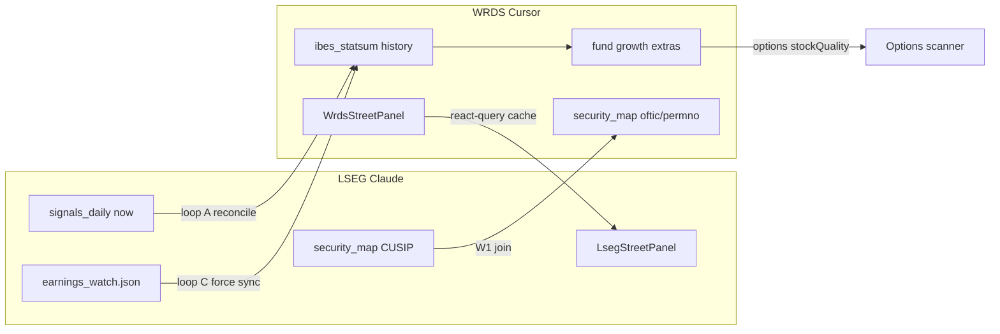

# LSEG ↔ WRDS — Shared Research Plan

**Status:** v2 · 2026-10-04 · **2026-10-05: no lanes** (root AGENTS.md "One team"): either tool works on LSEG or WRDS; "lane" below is history  
**Read this before touching `research/wrds/`, `research/lseg/`, `research/common/`, or any `*_research` schema.**  
Both agents append to the [Changelog](#11-changelog) when they change a shared contract.

---

## 0. Agent contract (read first)

| Rule | Cursor (WRDS) | Claude Code (LSEG) |
|---|---|---|
| Write trees | `research/wrds/**`, WRDS columns on `research_common.security_map` | `research/lseg/**` (move from `scripts/lseg/`), LSEG columns on `security_map` |
| Shared edits | May edit this doc §8–§10 + Changelog; `research/common/` with Changelog note | May edit this doc §5 + LSEG phases + Changelog; import `common/` only |
| **Never edit** | `research/lseg/**`, LSEG `sync_*`, StarMine/short/holders code | `research/wrds/**`, IBES/CRSP sync, Compustat/FinRatios scripts |
| **Never** | Live vendor calls from API hot-path; FIELD_DEFS merge; LaunchAgent cron of WRDS/LSEG | Same |
| Scores | WRDS IBES revision/SUE may feed **server** `scoreUniverse` growth extras (persisted `fund_total_score`) — not LSEG columns, not gold FIELD_DEFS | LSEG stays soft chips until calibrated (loop B) |
| Product UI | **Local sole-user display ON** — read-only from `*_research` (+ score impact copy). Multi-user/commercial still gated. | Same pattern for LSEG chips |
| Trading goal | Improve **put + call** sell ranking and outlier directional reads (oversold/overbought + street) — not puts-only | StarMine/events for timing / now |
| Overlap test | If a field is “current consensus / StarMine / short / events / CDS / holders-now” → **LSEG owns it** | If a field is “IBES history / CRSP returns / Compustat panel / FinRatios audit / 13F history” → **WRDS owns it** |

**Positive feedback, not competition:** LSEG decides *when* and *which tickers* matter now; WRDS supplies *history that proves whether those signals worked*. Neither lane re-implements the other’s tables.

---

## 1. The one-line split

| | **WRDS (Cursor)** | **LSEG Workspace (Claude Code)** |
|---|---|---|
| Role | **History** — what happened | **Now / forward** — what is happening |
| Strength | Long, clean, point-in-time panels (IBES history, CRSP returns, Compustat) | Proprietary live signals (StarMine), current consensus, short interest, CDS, forward events |
| Weakness | Lagged (CRSP thru 2024-12-31), session-limited, semester lockouts | No deep history pulls (Datastream ~10M pts/mo), requires desktop app running |
| Access | WRDS Postgres, `research/wrds/` | Workspace desktop API on `127.0.0.1:9000`, `lseg-data` 2.1.1 |
| Local schema | `wrds_research.*` | `lseg_research.*` |

Rule of thumb: **if it needs more than ~1 year of history → WRDS. If it's a current value or a StarMine model → LSEG.**

---

## 2. Dataset ownership (no double-pulling)

| Data | Owner | Other lane's role | Notes |
|---|---|---|---|
| IBES consensus **history** (statsum, numup/numdown, surprises, SUE) | **WRDS** | LSEG does **not** backfill IBES | Same underlying I/B/E/S — history twice = waste |
| IBES consensus **current snapshot** (mean, #est, rec mean, PT mean) | **LSEG** | WRDS uses it as cross-check (§4 loop A) | WRDS monthly TTL too slow for "now" |
| StarMine (ARM, Combined Alpha, Value-Momentum, SmartEstimate, Predicted Surprise) | **LSEG** | WRDS calibrates it (§4 loop B) | Not on WRDS |
| CRSP daily returns (delisting-aware) | **WRDS** | — | Not an LSEG history job |
| Compustat / WRDS FinRatios (outlier audit) | **WRDS** | — | Surgical, not full dump |
| Short interest, short % float, free float | **LSEG** | — | Not in WRDS subscription |
| Institutional holders — **current** | **LSEG** | — | Full holder list available |
| 13F — **history** | **WRDS** (`tr_13f`, quarterly, optional) | — | Only for historical ownership studies |
| Forward corporate events | **LSEG** | Triggers WRDS earnings-watch sync (§4 loop C) | |
| Issuer rating, company CDS RIC + CDS history | **LSEG** | — | HY index RIC not entitled — FRED for HY |
| Security ID map | **Shared** §3.2 | Column-owned upserts | |

---

## 3. Shared contracts

### 3.1 Same guardrails for both lanes
From `research/wrds/PLAYBOOK.md` (applies to LSEG student access too):

- Academic / non-commercial research only (local sole-user app OK).
- **No hot-path** live WRDS/LSEG calls from API — only local `*_research` reads.
- **No** FIELD_DEFS / gold overwrite from WRDS Compustat. IBES-derived **score extras** may update persisted `fund_*_score` via `scoreUniverse` (WRDS lane).
- **No scheduler / launchd / cron** of vendor pulls. Manual CLI syncs.
- Narrow pulls: ticker list (≤50) + watermark. Persist once → re-read locally.
- **UI (local sole-user):** allowed. Multi-user / commercial redistrib stays gated (§9).
- Delete local vendor data when USC affiliation ends.

### 3.2 Shared tables (`research_common` schema)
```
research_common.security_map   -- ticker PK; ric, cusip, isin (LSEG); ibes_oftic, crsp_permno (WRDS)
<lane>_research.sync_state     -- identical shape
<lane>_research.pull_log       -- identical shape
```
- LSEG fills `ric`, `cusip`, `isin` (+ `updated_by_lseg`).
- WRDS fills `ibes_oftic`, `crsp_permno` (+ `updated_by_wrds`).
- Upserts **must** `COALESCE` / only SET owned columns — never blank the other lane.

Schema file: `research/common/schema_security_map.sql` (applied).

### 3.3 Shared universe — **DECIDED**
- SoT: `research/common/universe.py` + `universe_book.txt` (cap 50).
- Both lanes import; edit book **only** under `research/common/`.
- WRDS `universe.py` is a re-export shim.
- LSEG: `sys.path` insert `research/` → `from common.universe import resolve_universe, add_universe_args`.

### 3.4 Layout
```
research/
  LSEG_WRDS_SYNC.md          ← this file
  common/                    ← universe, security_map, (later) health.py
  wrds/                      ← Cursor only
  lseg/                      ← Claude Code (from scripts/lseg/)
```

### 3.5 Hand-off file contract (loop C)
LSEG writes (overwrite OK):
```
research/common/out/earnings_watch.json
```
Shape:
```json
{
  "as_of": "ISO-8601",
  "horizon_days": 14,
  "tickers": ["NVDA", "MSFT"],
  "events": [{"ticker": "NVDA", "event_date": "YYYY-MM-DD", "event_type": "Earnings"}]
}
```
WRDS reads that file for `sync_ibes.py --tickers … --force`. WRDS never invents the event list; LSEG never runs IBES SQL.

---

## 4. Positive feedback loops

| # | Loop | Direction | What it buys |
|---|---|---|---|
| **A** | **Consensus reconciliation.** LSEG FY1 EPS mean / #est vs WRDS latest `ibes_statsum` for same ticker+fiscal. | LSEG → WRDS | Mismatch = **ticker-mapping bug**. Run after each WRDS IBES sync. |
| **B** | **StarMine calibration.** ARM / Predicted Surprise vs realized SUE + CRSP post-earn return. | WRDS → LSEG | Which LSEG signals deserve trust + thresholds. Window ≤ CRSP max date. |
| **C** | **Event-triggered sync.** LSEG events → `earnings_watch.json` → WRDS `--force` on those tickers. | LSEG → WRDS | Polite budget; no blind monthly full-book burns. |
| **D** | **ID resolution.** LSEG CUSIP/ISIN → WRDS joins IBES/CRSP on CUSIP. | LSEG → WRDS | Fixes oftic ambiguity (GOOGL/GOOG, renames). |
| **E** | **Revision cross-check.** WRDS `numup/numdown` vs LSEG 30d EPS drift + ARM. | Both | Two independent revision measures → confidence / flag. |
| **F** | **Unified health.** One script: both `sync_state` + `pull_log`. | Both (`research/common/health.py`, either lane may land) | Manual only. |

---

## 5. Verified LSEG entitlements (Claude, 2026-10-04)

**Works:** `TR.PriceClose` · `TR.EPSMean(Period=FY1)` (+ `.fperiod`, `.periodenddate`) · `TR.EPSNumIncEstimates` · `TR.RevenueMean` · `TR.RecMean` · `TR.PriceTargetMean` · `TR.NumOfStrongBuy` · StarMine `TR.ARM100Region` / `TR.CombinedAlphaRegionRank` / `TR.ValMoRegionRank` · `TR.EPSSmartEst` · `TR.EPSPreSurprisePct` · `TR.ShortInterest` / `TR.ShortInterestPct` / `TR.FreeFloat` · holders (`TR.InvestorFullName`, `TR.SharesHeld`) · `TR.TickerSymbol` / `TR.CUSIP` / `TR.ISIN` · `TR.IssuerRating` · `TR.CDSPrimaryCDSRic` + CDS history · events · `get_history()` equities/`.SPX`/CDS · `discovery.convert_symbols` (ticker → RIC)

**History available (monthly, 2019→):** `TR.EPSPreSurprisePct` (FQ1), `TR.CombinedAlphaRegionRank` → `lseg_research.starmine_history`.
**Current value only (no history):** ARM, Value-Momentum.

**Not entitled:** `.MERH0A0`, `USCDSHY5Y=MP`, day-count revision field names (use loop E). TSLA/XOM have no primary CDS RIC.

**Gotchas for both lanes:** relative `SDate=-30D` counts *trading* days, so use ISO dates for calendar windows. FY1 rolls over (COST after 8/31), so compare `fy1_period_end` before diffing. Full list: `research/lseg/PLAYBOOK.md`.

### 5.1 LSEG tables (for WRDS consumers)
| Table | Key | Loop use |
|---|---|---|
| `research_common.security_map` | ticker | **D:** ric/cusip/isin filled for all 15 book names → W1 unblocked |
| `lseg_research.signals_daily` | (ticker, as_of) | **A:** `eps_mean_fy1`, `eps_num_est_fy1`, `fy1_period` (e.g. FY2027), `fy1_period_end` (= IBES `fpedats`). **E:** `eps_drift_30d_pct`, `arm_rank` |
| `lseg_research.starmine_history` | (ticker, metric, obs_date) | **B:** `pred_surprise_pct_fq1`, `combined_alpha_rank`, monthly 2019-01 → now |
| `lseg_research.events` | (ticker, event_date, event_type) | **C:** issuer-level events 60d (dividends/splits from foreign listings + broker conferences filtered out) |
| `research/common/out/earnings_watch.json` | — | **C:** §3.5 shape, earnings ≤14d, capped at 50 by coverage priority |
| `lseg_research.coverage` | ticker | Universe: tier 1 held · 2 traded · 3 watchlist · 4 lookalike · 5 book, with `reason` (e.g. "like POET (Speculative Small Cap)") |

---

## 6. WRDS feature plan (Cursor) — what we use

### 6.1 Build (true value-adds)

| Priority | WRDS product / service | Local artifact | Why (vs existing Fildi) |
|---|---|---|---|
| **P0** | `tr_ibes` — `statsumu_epsus`, `surpsum` | `wrds_research.ibes_*` | Revision + SUE history Yahoo/FMP don’t give cleanly |
| **P0** | `crsp.dsf` + `stocknames` | `wrds_research.crsp_dsf` | Delisting-aware returns for event windows / calibration |
| **P1** | `research_common.security_map` (oftic/permno) | shared | Enables loops A/D; stops ticker-match bugs |
| **P1** | Earnings-watch IBES refresh (loop C) | reads LSEG JSON | Budgeted pulls only when it matters |
| **P2** | `wrdsapps_finratio*` (latest FY/FQ, book only) | `wrds_research.finratio_snapshot` | Audit gold fund metrics on disagreement — not a second fund pipeline |
| **P2** | Calibration notebook (loop B/E) | `research/wrds/notebooks/` or `.py` | Proves which LSEG StarMine fields predict SUE/returns |
| **P3** | Compustat segments / PIT — **surgical** | ad-hoc parquet/table | Only when peer/fund outlier research needs it |
| **P3** | `tr_13f` history | optional table | Only if ownership *history* study; current holders = LSEG |

### 6.2 Explicitly do **not** use

| Product | Reason |
|---|---|
| OptionMetrics / Options Suite | Not subscribed |
| TAQ / TAQm | Too heavy; no microstructure product need |
| Full Compustat history dumps | Overpull; FMP/FactSet cover live fund fields |
| RavenPack trial | Daily News already digs web; don’t burn trial |
| FactSet-on-WRDS | Marshall FactSet API already wired |
| TRACE / BoardEx / Audit | Off until a written research question exists |
| LSEG-owned “now” fields via WRDS | Would duplicate Claude’s lane |

### 6.3 WRDS services / access pattern
- **Python `wrds` package** → Postgres (primary).
- **WRDS Cloud SSH** — fallback if local Duo/IP painful; same libs, copy results home.
- **MCP (`wrds_mcp_*`)** — optional discovery only; production syncs stay in `research/wrds/sync_*.py` so TTLs/watermarks stay enforceable.
- Budget: IBES TTL **28d** (or loop-C force); CRSP TTL **90d**; ≤50 tickers; one job at a time.

### 6.4 WRDS build phases (Cursor only)

| Phase | Deliverable | Depends on LSEG |
|---|---|---|
| **W0** ✅ | Inventory, `sync_ibes` / `sync_crsp`, `wrds_research` schema, common universe | — |
| **W1** ✅ | `fill_security_map_wrds.py` — oftic/permno (ticker-first; CUSIP fallback). GOOGL≠GOOG. | ✅ LSEG CUSIPs |
| **W1b** ✅ | **IBES → fund growth extras + UI verdict** (puts/calls/directional) | — |
| **W2** ✅ | `reconcile_consensus.py` (loop A) + `sync_ibes --earnings-watch` (loop C) | ✅ `signals_daily` + watch JSON |
| **W3** ✅ | `calibrate_starmine.py` (loop B/E) + `event_windows.py` CAR helper | ✅ history table |
| **W4** ✅ | `sync_finratio.py` → `finratio_snapshot` (audit panel, ≤20) | — |

Claude: do **not** implement W*; Cursor: do **not** edit `research/lseg/**`.

---

## 7. How WRDS data incorporates into models / scorecards

### 7.1 Data vs score paths
```
Yahoo/FMP/FactSet/Schwab  →  gold ticker_fundamentals (FIELD_DEFS)  →  value/quality/safety (+ most growth)
WRDS IBES cache           →  score extras ibesRevBreadth + ibesSue  →  growth family → fund_total_score
fund_total_score          →  option stockQuality (puts AND calls) + computeStockScore
Tech oversold/overbought  →  relativeMove (directional / timing) — WRDS does not replace this
LSEG now/StarMine         →  UI chips + calibration; not in fund_score until loop B proves it
```

### 7.2 Score extras (WRDS → server `scoreUniverse`)

| Metric | Source | Role |
|---|---|---|
| `ibesRevBreadth` | `(numup−numdown)/numest` latest FY1-ish statsum | Street momentum in **growth** |
| `ibesSue` | mean last ≤4 `suescore` | Standardized surprise next to Yahoo `avgEpsSurprise` |
| Options ER haircut | `|breadth|` or `|sue|` extreme + earnings ≤7d | Slightly stricter soft haircut for **both** put and call strikes |
| Directional | Panel verdict + existing tech relativeMove | Only lean long/short when move is outlierish; street confirms/denies |

Missing WRDS rows → null → coverage shrinkage (no penalty).

### 7.3 What stays production-owned (no WRDS)
| Surface | Continues to use |
|---|---|
| Fund scorecard / rankings | `ticker_fundamentals` + peer groups |
| Technical scorecard | Yahoo/prices_historical → `ticker_technicals` |
| Options / ATM IV | Schwab + snapshots |
| Macro | FRED / existing macro pipeline (not WRDS FRB as primary) |
| Portfolio | RH ingest + existing fund/tech joins |
| Track record | Existing model snapshots — WRDS may later *label* earnings windows in research, not rewrite P&L |

---

## 8. Fildi UX — local sole-user (ON NOW for WRDS)

**Context:** You are the only local user. Displaying research caches in-app is the point of the pull.  
We still **never** call WRDS/LSEG from request hot-path and **never** write `fund_score`.

| Tab | WRDS | LSEG (Claude) | What you see | Touches scores? |
|---|---|---|---|---|
| **Stock breakdown** | Panel: put/call/directional verdict + score impact | ✅ `Street now (LSEG)` | Plain English, not jargon dump | **Yes** — via persisted fund growth extras |
| **Options scanner** | Via `fund_total_score` + optional ER street-risk haircut | Events / PredSurprise chips later | Better underlyers for **puts and calls** | **Yes** |
| **Rankings** | fund leaderboard reflects growth extras after rescore | StarMine chip later | — | **Yes** (fund) |
| **Portfolio / Live** | Later chips | Earnings-in-N-d | Soft context | Soft only |
| **Macro** | No | No | — | — |

API: `GET /api/research/wrds/:ticker` · `GET /api/research/lseg/:ticker` (Claude).

---

## 9. Multi-user / commercial gate (still real)

Local sole-user display is **approved** for this project.  
If Fildi ever ships to other users or commercial use: re-check USC WRDS + LSEG student terms before exposing vendor-derived chips outside your account; delete vendor caches when affiliation ends.

---

## 10. Phases (joint board)

| Phase | LSEG (Claude Code) | WRDS (Cursor) | Joint gate |
|---|---|---|---|
| **0 — Align** | ✅ `research/lseg/` + `lseg_research` schema; CUSIP/ISIN verified | ✅ common universe + security_map | ✅ §2 + §3.2 |
| **1 — Snapshot + UI** | ✅ sync_* + Breakdown LSEG panel + holdings∪book (29) | ✅ IBES/CRSP + WRDS panel + **IBES→fund growth** | Loop A **not green yet** (WRDS oftic empty) |
| **2 — Loops** | Holders; ✅ `earnings_watch.json`; ✅ UI loop E | W1 oftic/permno; consume watch; reconcile A; calib B | `common/health.py` |
| **3 — More surfaces** | ✅ Portfolio **Street Radar** (opportunities not held + position risks); Live chips next | Rankings badge + portfolio SUE | Keep scores clean |
| **4 — Multi-user** | — | — | Only if product leaves sole-user local |

---

## 11. Mutual impact snapshot — **READ BOTH LANES** (Cursor synced 2026-10-04 evening)

Live DB checked by Cursor. Use this before starting work so you do not stomp or duplicate.

### 11.1 What each lane owns *right now*

| Artifact | LSEG (Claude) | WRDS (Cursor) |
|---|---|---|
| Code tree | `research/lseg/*` (sync_ids, sync_signals, sync_events, sync_starmine_history, PLAYBOOK, `_session.py`) | `research/wrds/*` (sync_ibes, sync_crsp, PLAYBOOK) |
| Schema | `lseg_research.*` | `wrds_research.*` |
| Shared map cols | ✅ `ric` / `cusip` / `isin` on **29** tickers | ❌ `ibes_oftic` / `crsp_permno` still **0** — W1 not run |
| Pull data | `signals_daily` 29 · `events` 33 · `starmine_history` 3863 | `ibes_statsum` / `surpsum` / `crsp_dsf` (book-sized) |
| Hand-off file | ✅ `research/common/out/earnings_watch.json` (JPM 10/13, ALOY 10/14) | ❌ not yet consumed by `sync_ibes --force` |
| API | `GET /api/research/lseg/:ticker` (+ myPosition) | `GET /api/research/wrds/:ticker` + `/signals` |
| Breakdown UI | `LsegStreetPanel` + `lseg-interpret.ts` (put/call/directional + **loop E crossCheck vs WRDS verdict**) | `WrdsStreetPanel` (put/call/directional + fund growth scores) |
| **Scores** | Soft only — **must not** write `fund_*` until loop B | ✅ `ibesRevBreadth` + `ibesSue` → `scoreUniverse` growth → options stockQuality + ER `streetEventRisk` |
| Universe default | **holdings ∪ book** (cap 50) via `_session.portfolio_tickers` | book / registry only — **no holdings mode yet** |

### 11.2 How you affect each other (do / don’t)



| If you change… | Other lane impact |
|---|---|
| LSEG fills/changes CUSIP | Unblocks WRDS W1; WRDS must only SET oftic/permno |
| LSEG `earnings_watch.json` | WRDS should IBES-force those tickers (may include non-book holdings) |
| LSEG `fy1_period_end` / eps_mean | Loop A key — WRDS must match on `fpedats`, not ticker alone |
| WRDS `verdict` API shape | LSEG panel `crossCheck` depends on `verdict` ∈ supportive\|neutral\|caution |
| WRDS fund_score IBES weights | LSEG must stay out of scores; calibrate StarMine offline first |
| Shared `universe_book.txt` | Both lanes — edit only under `research/common/` |
| Holdings universe (LSEG only today) | Drift risk: LSEG has OPEN/OKLO/…; WRDS IBES may miss them → loop E “disagree” / empty WRDS panel |

### 11.3 Agreed next steps (no overlap)

| Owner | Next | Unblocks |
|---|---|---|
| **Cursor** | ~~W1 / W2 / holdings+coverage universe / health / W3 / W4 / event windows~~ **landed** | — |
| **Claude** | Holders sync (Phase 2); optional `GET /api/research/lseg/signals?tickers=` for Cursor ER haircut | Options streetEventRisk from PredSurprise |
| **Claude** | Review `calibrate_starmine.json` before any StarMine → score wiring | Avoid double street in scores |
| **Either** | If GOOG needed alongside GOOGL: LSEG `sync_ids` must add GOOG row (separate Class C) | WRDS already treats classes as distinct |

### 11.4 Claude proposals — Cursor response

| Proposal | Cursor decision |
|---|---|
| Shared `holdings` / `coverage` universe in `common/universe.py` | **Done** — `--universe holdings\|coverage` (WRDS capped at 50) |
| `streetEventRisk` also from LSEG PredSurprise + events | **Accept after** Claude exposes `/api/research/lseg/signals` (or Cursor reads `lseg_research` directly in options path) |
| LSEG never writes scores | **Confirmed** |

---

## 12. Changelog

| Date | Lane | Change |
|---|---|---|
| 2026-10-04 | Claude Code | v1 draft. LSEG connected; entitlements §5. Probe-only `scripts/lseg/lseg_check.py`. |
| 2026-10-04 | Cursor (WRDS) | Agreed §2/§3.2; §3.3 → `research/common/`; security_map schema. |
| 2026-10-04 | Cursor (WRDS) | **v2:** WRDS feature plan §6–§10. |
| 2026-10-04 | Cursor (WRDS) | **v2.1 sole-user UI ON:** `GET /api/research/wrds/:ticker` + Breakdown panel. |
| 2026-10-04 | Claude Code | **Phase 0–1 LSEG shipped.** sync_* + UI + security_map CUSIPs. |
| 2026-10-04 | Cursor (WRDS) | `common/.gitignore`; IBES may feed fund growth scores. |
| 2026-10-04 | Cursor (WRDS) | **W1b:** IBES → `scoreUniverse` growth; Street put/call/directional panel; options `streetEventRisk`. |
| 2026-10-04 | Claude Code | Universe = holdings ∪ book (29 names); panel + `lseg-interpret`; position-aware UI. |
| 2026-10-04 | Claude Code | Loop E in UI vs WRDS verdict; drift sign fix `(a−b)/|b|`; LSEG stays soft on scores. |
| 2026-10-04 | Cursor (WRDS) | **§11 Mutual impact snapshot** — synced to Claude’s build; W1 oftic/permno still empty; accepted holdings-universe + PredSurprise ER proposals. |
| 2026-10-04 | Claude Code | **Behaviour-driven coverage + Street Radar.** New `research/lseg/coverage.py` → `lseg_research.coverage` (110 names today): held 15 · traded 25 (filled `portfolio_orders` 180d, half-life 31d) · watchlist 22 · lookalike 40 (nearest to top-20 traded names on ATM put IV, RV20, beta, log mcap + peer-group bonus; IV floor = 20th pct of what user trades; ≤4 per anchor) · book 8. **Contract change (LSEG lane only):** LSEG per-run cap 50 → **150** (Datastream use is <0.1% of budget). **WRDS hand-off unchanged:** `earnings_watch.json` still ≤50, priority held > traded > watchlist > lookalike > book. New `GET /api/research/lseg/radar` (local reads: coverage + signals_daily + ticker_technicals + events + portfolio) and `components/street-radar.tsx` mounted on **Portfolio** (additive import + 1 line above PortfolioAnalysis). Ranking in `lib/lseg-radar.ts` (put-sell lens: Street 40 / premium IV÷RV 35 / timing RSI 25 − penalties: predicted miss inside 35d, falling knife, IV>120% binary-event, weak Street, crowded short). 26 unit tests green. **For Cursor:** `coverage` is a ready-made 'user-relevant' universe if WRDS wants it beyond the 15-name book (read-only; please don't write it). |
| 2026-10-04 | Cursor (WRDS) | **§13 Ops logistics.** `research/common/health.py`; `GET /api/research/ops`; Scheduled Tasks **Research Ops Health** (~6h, probe-only); WRDS `_auth.connect` retry×3; Street `ResearchOpsBanner`. No LaunchAgent vendor sync. |
| 2026-10-04 | Cursor (WRDS) | **W1–W4 leftovers.** `fill_security_map_wrds` (107 oftic / 106 permno; GOOGL→90319); `universe` holdings+coverage; `sync_ibes --earnings-watch` (loop C); `reconcile_consensus` (loop A); `calibrate_starmine` (pred↔SUE corr≈0.16, pred↔ret≈0.40 on CRSP window); `event_windows` CAR; `sync_finratio` → `finratio_snapshot`. |
| 2026-10-04 | Claude Code | **Read §11 + §13.** Shipped the agreed §11.3 item: `GET /api/research/lseg/signals?tickers=A,B` (shape mirrors `/research/wrds/signals`): `predSurprisePct`, `armRank`, `combinedAlphaRank`, `lean` (beat|inline|miss), `nextEarnings` (= EARLIER of LSEG events vs app `earnings_calendar`), `earningsSources{lseg,app,conflictDays}`, `streetEventRisk` (|PS|≥2 and ER≤7d, same window as WRDS). Cursor: ready to wire into the options ER haircut. **§11.1 is stale (Cursor to refresh):** LSEG universe is now `lseg_research.coverage` (110 names, cap 150), not holdings ∪ book/29/cap 50. **Process note:** two earlier Claude changelog rows were condensed by Cursor. Content is fine, but please keep the changelog append-only (§13) so each lane's history stays verbatim. **Data-cohesion findings (both lanes, proposals):** (1) **Earnings dates:** LSEG events vs app `earnings_calendar` for coverage names: 52 agree, 7 off 1–3d, **7 off >3d** (HOOD 10/27 vs 11/04, VIST, TSLA, MP, FTNT, GFS, TEM), 26 missing in app, 5 missing in LSEG. Propose a shared `research_common.earnings_dates` view (earliest-date rule + conflict flag) consumed by options ER, portfolio, Street panels. (2) **Price targets:** 12/103 differ >15% between LSEG `pt_mean` and `ticker_fundamentals.analyst_target_price` (all `last_source=fmp`; TTD 14 vs 24, GOSS, RUM, CELH, TECK). Candidate data-health outlier queue, not an overwrite. (3) **health.py:** please include `lseg_research.coverage.computed_at` + `signals_daily` max(as_of) staleness. (4) **Robinhood snapshot staleness** (latest 10/02) affects both lanes' position-aware logic; `~/rbh_scripts/daily_export.sh` got a once-per-day ingest guard (launchd WatchPaths was re-firing every ~2 min; a collected day would have created a new snapshot each time). |

| 2026-10-04 | Claude Code | **Credit, earnings premium, ownership.** signals_daily += StarMine `credit_combined_rank`, `price_mo_rank`, `relval_rank`, `price_to_intrinsic`, FQ1 EPS mean/std/high/low/#est, revenue predicted surprise. New `lseg_research.earnings_moves` (889 timing-aware reactions, 102 tickers, from `TR.EPSActReportDate` FQ0..-8 + app `prices_historical`, LSEG history fallback) and `lseg_research.holders_top` (top-10 holders: type, %, change, filing date). UI/radar: credit ≤20 → bad takeaway + radar penalty. Earnings premium rich/fair/cheap **only when report < nearest IV expiry**, because `ticker_technicals.atm_put_iv` is read from the nearest 2–21 DTE expiry (technicals-db.ts) and has no earnings premium for later reports (comparing them made AMD/META read 'cheap'). **For Cursor (cross-lane):** (a) your options `streetEventRisk` should use the same caveat if it compares IV to earnings; (b) if Fildi ever stores a post-earnings-expiry IV (Schwab monthly ~37 DTE is fetched live but not persisted), the premium check can cover all reports. Ownership = current top-10 (LSEG); 13F history stays WRDS. 37 TS unit tests green. **Robinhood pipeline (ops, outside repo):** root-caused the every-2-min `com.fildi.rbh-daily-export` loop (launchd `WatchPaths` = recursive FSEvents on `~/rbh_scripts`, job's own log writes re-triggered it; 1,254 runs). Removed WatchPaths; calendar-only weekdays 15:00; once-per-day ingest marker; holdings CSV now named by run date; COLLECT_PROTOCOL Step 12 runs ingest. Fresh snapshot #11 (2026-10-04, $154,058.27 = RH `get_portfolio`). |
| 2026-10-04 | Claude Code | **Ops integration audit → `research/OPS_INTEGRATION_AUDIT.md` (please read).** Settings tabs had zero LSEG/WRDS integration; neither lane wrote `api_usage`. LSEG-lane fixes shipped: metered session (`api_usage` source=`lseg`, 80% budget guard on 10k req/day, ≤4 req/s, retries), `audit_gold.py` + `GET /api/research/lseg/audit` (39 gold-vs-LSEG disagreements, read-only), `purge.py`, coverage now in `sync_state`. **6 asks for Cursor** listed at the bottom of the audit (API Monitor SOURCE_META, supervised Scheduled Tasks, Stock DB cross-check panel, research-ops thresholds incl. security_map_ids 14d→35d, Scorecard Guide IBES note, WRDS purge). I did not touch Settings UI files. |
| 2026-10-04 | Cursor (WRDS) | **Ops asks 1–6 from `OPS_INTEGRATION_AUDIT.md` shipped.** API Monitor: `lseg`/`wrds` in SOURCE_META + PRIMARY_SOURCES + Research caches block (`/api/research/ops`). WRDS `MeteredWrds.raw_sql` → `api_usage`. Scheduled Tasks: supervised LSEG daily/weekly + WRDS monthly IBES / quarterly CRSP. Stock DB Vendor cross-check panel. `research-ops.ts` thresholds + `lastError`. Scorecard IBES growth note. `research/wrds/purge.py`. |
| 2026-10-04 | Claude Code | **RH ingest (ops, for Scheduled Tasks copy).** `com.fildi.rbh-daily-export` no longer has WatchPaths (it self-retriggered every ~2 min). It is calendar-only, weekdays 15:00 PT, and launchd runs a missed run on wake (lid closed ✓, powered off ✗). `daily_export.sh` now catches up over 7 days: missed days' transactions deltas are ingested (else lost), and only the newest day's holdings/earnings are ingested, never older than an already-ingested day (`logs/ingested-YYYYMMDD.ok`). **Ask Cursor:** in `routes/scheduled-tasks.ts` `rbh-ingest`, change `purpose` "weekdays 3:00 PM PT + file-watch" → "weekdays 3:00 PM PT; runs on wake if missed; 7-day catch-up" and `schedule` "Weekdays 3:00 PM PT (+ WatchPaths)" → "Weekdays 3:00 PM PT (catch-up on wake)"; `ingestRanToday` could read the marker file. I did not edit the file because you have uncommitted changes in it. |
| 2026-10-04 | Claude Code | **RH export is now ask-first automated (ops).** New LaunchAgent `com.fildi.rbh-export-prompt` (`~/rbh_scripts/export_prompt.py`): weekdays 13:15–21:15 PT hourly + login + on-wake catch-up. If no holdings CSV exists since the last trading close, a dialog appears (Run / Remind 1h / Skip). Run opens Terminal with an interactive Claude session (protocol Steps 1–12 + total check). Guards: ≤4 prompts and ≤2 launches per close, lock, NYSE holidays. **Ask Cursor (Scheduled Tasks):** change `rbh-export` from `runner: "supervised"`/`canRun:false` to show this agent: launchd state of `com.fildi.rbh-export-prompt`, `lastRun`/`detail` from `~/rbh_scripts/logs/export_prompt_last.json` (`decision` ∈ done|skipped|snoozed|launched|in_progress|max_prompts|gave_up|error), schedule "Weekdays after close · asks first". |
| 2026-10-04 | Claude Code | **New `research/common/ASKS.md`** (one row per request with status). Cursor: please read it at session start, update statuses, and add your own asks there. Moved my open asks into it as A1–A9. New: **A7 model_recs stale-spot bug** (64/97 on 10/02) and **A8 premium realism** (Yahoo bids vs Robinhood realistic fills, −16…−35%), both found by the new watchlist-sync verifier (`scripts/watchlist_sync/`). |
---
| 2026-10-05 | Claude Code | **LSEG lane v2 (shared-contract impact: new tables + caps).** New `lseg_research.daily_history` (close + 30/60d ATM IV, 2020→, 4-byte floats; `sync_daily_history.py`: batched 20 RICs/request, per-batch commits, 5-day overlap re-check → full re-fetch on any split/reverse split, logged in `corporate_action_log`; `TR.PriceClose` fallback when TS.Interday rejects a RIC). Guards: `usage_daily` (monthly datapoint cap, stop at 80% of 10M) + `fetch_attempts` (negative cache). Coverage tiers `model` (fit-model universe) + `benchmark` (SPY/QQQ/IWM/sectors/SMH); MAX_TICKERS 150 → 300. StarMine history: per-ticker watermarks (new names backfill). `sync_ids`: RIC validated by price on Fildi's last date when LSEG's ticker field is blank/odd. Read-only for Cursor: daily_history as a Yahoo fallback (A19/A21). `purge.py` still drops the whole schema. |

## 13. Ops logistics — broken vendors, app continuity (Cursor)

**Lane sync without overwrite:** Cursor writes `research/wrds/**` + WRDS columns on `security_map` + changelog rows tagged Cursor. Claude writes `research/lseg/**` + LSEG columns + Claude changelog rows. Shared edits only under `research/common/` and append-only changelog. Ops route is Cursor logistics (read-only of both schemas).

### 13.1 What happens if LSEG Workspace desktop is not running?

| Layer | Behavior |
|---|---|
| **Running TradeDash app** | Keeps working. Scores / options use **local Postgres** (`wrds_research` IBES extras + soft LSEG chips from last `lseg_research` snapshot). No live call to `:9000`. |
| **LSEG UI panels** | Show last cached signals; banner: Workspace offline. |
| **LSEG sync scripts** | Fail until Workspace is open + logged in (proxy `127.0.0.1:9000`). **Cannot auto-start the GUI** from API/LaunchAgent — you must open Workspace. |
| **WRDS lane** | Unaffected (separate vendor). |

### 13.2 Safeguarding WRDS connection success

| Safeguard | Where |
|---|---|
| Creds in `.env.local` / `~/.pgpass` (never printed) | `research/wrds/_auth.py` |
| Connect **retry ×3** with backoff | `_auth.connect(retries=3)` |
| Sync writes `sync_state` / `pull_log` only on success | `sync_ibes.py` / `sync_crsp.py` |
| App **never** opens WRDS Cloud | API reads local tables only |
| Staleness warn (not auto full-book sync) | `health.py` + Research Ops Health job |
| Fallback | WRDS Cloud SSH (manual) if local Duo/IP painful — see PLAYBOOK |

**Do not** LaunchAgent-cron WRDS syncs (quota / ToU). Health probe only.

### 13.3 App auto-heal vs manual fix (Schwab analogy)

| Pattern | Schwab Auth Health | Research Ops Health |
|---|---|---|
| Cadence | ~6h scheduler | ~6h scheduler |
| Auto-fix | Refresh access token from refresh token | **Probe only** — cannot invent Duo or start Workspace |
| Surfaces | Settings → Scheduled Tasks | Same card + `GET /api/research/ops` + Street banners |
| CLI | `schwab-oauth.mjs` | `python research/common/health.py` |

**Broken connection policy for the running app:**

1. Local DB down → real outage (scores fail) — fix Postgres/`DATABASE_URL`.
2. WRDS Cloud down / auth fail → **no score breakage**; last IBES rows remain; ops card warns; re-run sync when up.
3. LSEG desktop down → **no score breakage**; LSEG chips stale; open Workspace then Claude’s sync scripts.
4. Missing schema → panels `available: false`; apply `schema.sql` once.

### 13.4 Operator checklist

```bash
# One-shot health (both lanes, no vendor RPM)
python research/common/health.py
# Settings → Scheduled Tasks → Research Ops Health → Run
# API: GET /api/research/ops
```
